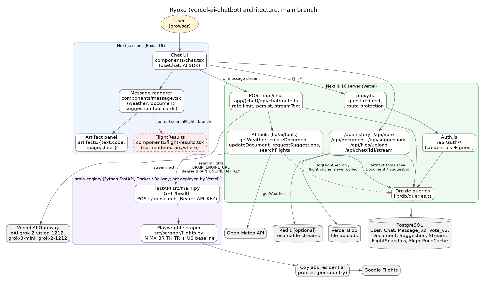

<h1 align="center">Ryoko</h1>

<p align="center">
  An AI travel assistant that searches flight prices from several countries to find cheaper fares.
  Built on a fork of <a href="https://github.com/vercel/chatbot">vercel/chatbot</a> (Chat SDK) with Next.js and the AI SDK.
</p>

<p align="center">
  <a href="docs/architecture.md"><strong>Architecture</strong></a> ·
  <a href="#features"><strong>Features</strong></a> ·
  <a href="#model-providers"><strong>Model Providers</strong></a> ·
  <a href="#running-locally"><strong>Running locally</strong></a> ·
  <a href="brain-engine/README.md"><strong>Brain Engine</strong></a>
</p>
<br/>

## Architecture

The repo has two deployable parts: the Next.js chat app (this directory, deployed to Vercel) and `brain-engine/`, a Python FastAPI service that scrapes Google Flights through country-specific proxies. The chat app's `searchFlights` tool calls the Brain Engine over HTTP.



See [docs/architecture.md](docs/architecture.md) for components, the flight search flow, the data model, configuration and known gaps. The diagram source is [docs/diagrams/architecture.dot](docs/diagrams/architecture.dot) ([SVG](docs/diagrams/architecture.svg)); re-render it with:

```bash
cd docs/diagrams
dot -Tpng -Gdpi=96 architecture.dot -o architecture.png
dot -Tsvg architecture.dot -o architecture.svg
```

## Features

- Ryoko travel assistant
  - `searchFlights` AI tool ([lib/ai/tools/search-flights.ts](lib/ai/tools/search-flights.ts)) backed by the [Brain Engine](brain-engine/README.md), which compares fares found from India, Mexico, Brazil, Thailand and Turkey against a US search
  - `FlightSearches` and `FlightPriceCache` tables in the Drizzle schema (not written to yet, see [known gaps](docs/architecture.md#known-gaps))
- [Next.js](https://nextjs.org) 16 App Router
  - React Server Components and Server Actions
- [AI SDK](https://ai-sdk.dev/docs/introduction) 5
  - Streaming chat with tool calls (`getWeather`, `createDocument`, `updateDocument`, `requestSuggestions`, `searchFlights`)
  - Artifacts panel for text, code, image and sheet documents
- [shadcn/ui](https://ui.shadcn.com)
  - Styling with [Tailwind CSS](https://tailwindcss.com)
  - Component primitives from [Radix UI](https://radix-ui.com)
- Data persistence
  - PostgreSQL (for example [Neon](https://vercel.com/marketplace/neon)) through Drizzle ORM for users, chats, messages and documents
  - [Vercel Blob](https://vercel.com/storage/blob) for file uploads
  - Optional Redis for resumable streams
- [Auth.js](https://authjs.dev)
  - Email/password accounts and automatic guest sessions

## Model Providers

The app uses the [Vercel AI Gateway](https://vercel.com/docs/ai-gateway) with [xAI](https://x.ai) models ([lib/ai/providers.ts](lib/ai/providers.ts)):

| Model id in the app | Gateway model | Used for |
| --- | --- | --- |
| `chat-model` (Grok Vision) | `xai/grok-2-vision-1212` | Default chat, all tools |
| `chat-model-reasoning` (Grok Reasoning) | `xai/grok-3-mini` | Chat with reasoning, no tools |
| `title-model`, `artifact-model` | `xai/grok-2-1212` | Chat titles, artifact content |

### AI Gateway Authentication

**For Vercel deployments**: Authentication is handled automatically via OIDC tokens.

**For non-Vercel deployments**: Set `AI_GATEWAY_API_KEY` in `.env.local`.

With the [AI SDK](https://ai-sdk.dev/docs/introduction), you can also switch to direct LLM providers like [OpenAI](https://openai.com), [Anthropic](https://anthropic.com) and [many more](https://ai-sdk.dev/providers/ai-sdk-providers) with a few lines of code.

## Deploying

- **Chat app**: deploy this repository to Vercel. [vercel.json](vercel.json) leaves `brain-engine/` out of the build and skips builds when only `brain-engine/` changed. Set the variables from [.env.example](.env.example) in the Vercel project, including `BRAIN_ENGINE_URL` and `BRAIN_ENGINE_API_KEY` for flight search.
- **Brain Engine**: deploy `brain-engine/` separately as a container (for example Railway); see [brain-engine/README.md](brain-engine/README.md).

## Running locally

You need Node.js, pnpm 9 (`packageManager` in [package.json](package.json)), PostgreSQL, and the environment variables in [.env.example](.env.example). Do not commit your `.env.local`.

| Variable | Required | Notes |
| --- | --- | --- |
| `AUTH_SECRET` | yes | Generate with `openssl rand -base64 32` |
| `POSTGRES_URL` | yes | Any PostgreSQL database |
| `AI_GATEWAY_API_KEY` | yes, outside Vercel | Needed for model responses |
| `BLOB_READ_WRITE_TOKEN` | for file uploads | |
| `REDIS_URL` | no | Resumable streams are off without it |
| `BRAIN_ENGINE_URL` | for flight search | e.g. `http://localhost:8000` |
| `BRAIN_ENGINE_API_KEY` | for flight search | Same value as the Brain Engine's `API_KEY` |

If the project is linked to Vercel you can fetch them with `vercel link` and `vercel env pull`; otherwise copy `.env.example` to `.env.local` and fill it in.

```bash
pnpm install
pnpm db:migrate # create or update the database schema
pnpm dev
```

The app runs on [localhost:3000](http://localhost:3000). Without the Brain Engine variables, chat works and `searchFlights` returns a "not configured" error to the model.

To run flight searches locally, start the Brain Engine in another terminal (it needs Oxylabs proxy credentials):

```bash
cd brain-engine
cp .env.example .env   # fill in API_KEY and OXYLABS_*; remove or JSON-quote SEARCH_COUNTRIES
docker-compose up      # or: pip install -r requirements.txt && playwright install chromium && uvicorn src.main:app --port 8000
```

## Tests

```bash
pnpm test                                  # Playwright e2e and route tests (starts pnpm dev, uses mock models)
cd brain-engine && pip install -r requirements.txt && pytest   # Brain Engine API tests (scraper mocked)
```
