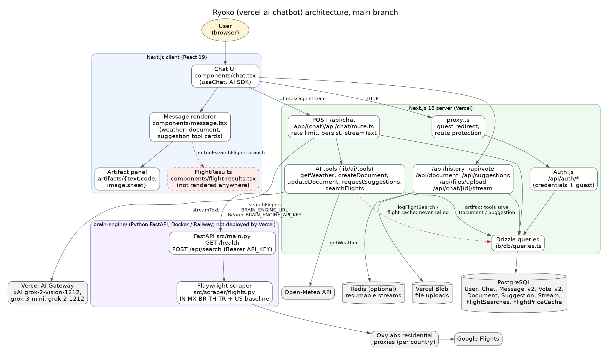

# Ryoko architecture

Ryoko is a travel assistant built on a fork of [vercel/chatbot](https://github.com/vercel/chatbot) (Chat SDK). It keeps the upstream Next.js chat app (auth, chat history, artifacts, streaming) and adds a flight-price search: a `searchFlights` AI tool that calls a separate Python service, `brain-engine/`, which scrapes Google Flights through proxies in several countries to find cheaper fares than a US search.

This page describes the `main` branch. The diagram source is [`docs/diagrams/architecture.dot`](diagrams/architecture.dot).

([SVG version](diagrams/architecture.svg). Dashed red parts exist in the code but are not wired in; see [Known gaps](#known-gaps).)

## Components

| Component | Where | What it does |
| --- | --- | --- |
| Chat UI | `components/chat.tsx`, `components/messages.tsx`, `components/message.tsx` | `useChat` from the AI SDK streams messages from `/api/chat` and renders text, reasoning, tool cards and artifacts. |
| Artifacts | `artifacts/{text,code,image,sheet}`, `components/artifact.tsx` | Side panel for documents created by the `createDocument` / `updateDocument` tools. |
| Route protection | `proxy.ts` | Next.js 16 proxy (middleware). Sends visitors without a session to `/api/auth/guest`, which signs them in as a guest user. |
| Auth | `app/(auth)/auth.ts`, `app/(auth)/api/auth/*`, `/login`, `/register` | Auth.js v5 with email/password credentials and a guest provider. User type (`guest` or `regular`) sets the daily message limit in `lib/ai/entitlements.ts` (20 or 100). |
| Chat API | `app/(chat)/api/chat/route.ts` | `POST` checks the session and rate limit, creates the chat (title generated by the model), saves the user message, runs `streamText` with tools, saves the assistant messages and token usage. `DELETE` removes a chat. |
| Other APIs | `app/(chat)/api/{history,vote,document,suggestions,files/upload,chat/[id]/stream}` | Sidebar history, message votes, artifact documents, edit suggestions, file uploads to Vercel Blob, and resumable stream replay. |
| Models | `lib/ai/providers.ts`, `lib/ai/models.ts` | Vercel AI Gateway with xAI models: `chat-model` = `xai/grok-2-vision-1212`, `chat-model-reasoning` = `xai/grok-3-mini` (reasoning middleware), titles and artifacts = `xai/grok-2-1212`. Tests use mock models from `lib/ai/models.mock.ts`. |
| System prompt | `lib/ai/prompts.ts` | Presents the assistant as Ryoko and tells it to call `searchFlights` for any flight request and never make up prices. |
| AI tools | `lib/ai/tools/` | `getWeather` (Open-Meteo), `createDocument`, `updateDocument`, `requestSuggestions`, `searchFlights`. All are active for `chat-model`; `chat-model-reasoning` has no tools. |
| Database | `lib/db/schema.ts`, `lib/db/queries.ts`, `lib/db/migrations/` | PostgreSQL through Drizzle ORM. |
| Brain Engine | `brain-engine/` | FastAPI service that runs the flight searches. See [brain-engine/README.md](../brain-engine/README.md). |

## Flight search flow

1. The user asks for flights. The model (`chat-model`) calls `searchFlights` with IATA codes, dates, passengers and cabin class (`lib/ai/tools/search-flights.ts`).
2. The tool reads `BRAIN_ENGINE_URL` and `BRAIN_ENGINE_API_KEY`. If either is missing it returns `{ success: false, error: "Flight search is not configured..." }` instead of calling anything.
3. It sends `POST {BRAIN_ENGINE_URL}/api/search` with `Authorization: Bearer <BRAIN_ENGINE_API_KEY>` (no client-side timeout is set).
4. Brain Engine (`brain-engine/src/main.py`) checks the bearer token against its own `API_KEY`, then `search_flights_multi_country` (`src/scraper/flights.py`) opens one Playwright Chromium per country in parallel, each through an Oxylabs residential proxy for that country (`src/scraper/proxy.py`), and reads Google Flights results. Countries come from `search_countries` in `src/config.py` (India, Mexico, Brazil, Thailand, Turkey by default), plus a US search used as the price baseline.
5. Results are sorted by price; each flight gets `original_price`, `savings_amount` and `savings_percent` against the cheapest US fare.
6. The tool maps the response to camelCase (`flights`, `bestPrice`, `baselinePrice`, `bestSavingsPercent`, `countriesSearched`, `searchTime`) and returns it to the model, which writes the answer as text.

Brain Engine endpoints:

| Method | Path | Auth | Purpose |
| --- | --- | --- | --- |
| GET | `/` | none | Service name and version |
| GET | `/health` | none | Health check |
| POST | `/api/search` | `Bearer API_KEY` | Multi-country flight search |

Swagger UI at `/docs` is only served when `DEBUG=true`.

## Data model

Upstream Chat SDK tables: `User`, `Chat`, `Message_v2`, `Vote_v2`, `Document`, `Suggestion`, `Stream` (plus the deprecated `Message` and `Vote`).

Ryoko adds two tables (migration `lib/db/migrations/0008_spicy_black_queen.sql`):

| Table | Columns | Intended use |
| --- | --- | --- |
| `FlightSearches` | `chatId`, `userId`, origin/destination, dates, passengers, cabin class, `bestPrice`, `baselinePrice`, `savingsPercent`, `resultsCount`, `searchDurationMs`, `createdAt` | Per-user search history (`logFlightSearch`, `getUserFlightSearches`) |
| `FlightPriceCache` | route, dates, passengers, cabin class, `results` (JSON), `createdAt`, `expiresAt` | Cache of Brain Engine results (`getCachedFlightPrices`, `setCachedFlightPrices`) |

## Configuration

Next.js app (`.env.example`):

| Variable | Required | Used for |
| --- | --- | --- |
| `AUTH_SECRET` | yes | Auth.js session signing |
| `POSTGRES_URL` | yes | Database |
| `AI_GATEWAY_API_KEY` | outside Vercel | AI Gateway (Vercel deployments use OIDC) |
| `BLOB_READ_WRITE_TOKEN` | for uploads | `/api/files/upload` |
| `REDIS_URL` | no | Resumable streams; disabled when unset |
| `BRAIN_ENGINE_URL` | for flight search | Brain Engine base URL, e.g. `http://localhost:8000` |
| `BRAIN_ENGINE_API_KEY` | for flight search | Must equal Brain Engine's `API_KEY` |

Brain Engine (`brain-engine/src/config.py`, template in `brain-engine/.env.example`): `API_KEY`, `OXYLABS_USERNAME` and `OXYLABS_PASSWORD` are required; `OXYLABS_ENDPOINT` (default `pr.oxylabs.io:7777`), `SEARCH_COUNTRIES`, `MAX_RESULTS_PER_COUNTRY`, `REQUEST_TIMEOUT`, `BROWSER_TIMEOUT`, `HEADLESS`, `API_HOST`, `API_PORT`, `DEBUG`, `REDIS_URL` and `CACHE_TTL` are optional. `SEARCH_COUNTRIES` must be a JSON list such as `["in","mx"]` (see [Known gaps](#known-gaps)).

## Deployment

- The Next.js app deploys to Vercel. `vercel.json` excludes `brain-engine/**` from the build and skips builds when only `brain-engine/` changed.
- Brain Engine runs as its own container (`brain-engine/Dockerfile`, Python 3.11 with Playwright Chromium, port 8000). `brain-engine/docker-compose.yml` runs it locally with an optional Redis; `brain-engine/README.md` describes a Railway deployment.
- CI (`.github/workflows/`): `lint.yml` runs `pnpm lint`; `playwright.yml` runs `pnpm test` with `POSTGRES_URL` and other keys from repository secrets. Brain Engine's pytest suite is not run in CI.

## Tests

| Suite | Command | Covers |
| --- | --- | --- |
| Playwright e2e | `pnpm test` (project `e2e`) | Chat, artifacts, reasoning, guest/regular sessions, using mock models |
| Playwright routes | `pnpm test` (project `routes`) | `/api/chat` and `/api/document` |
| Brain Engine | `cd brain-engine && pytest` | FastAPI endpoints with the scraper mocked |

No test covers `searchFlights`, the flight tables or `FlightResults`, and the mock models never call `searchFlights`.

## Known gaps

These are in the code on `main` as of this page; they are listed so the docs do not overstate what works.

- `components/flight-results.tsx` (`FlightResults`) is not imported anywhere, and `components/message.tsx` has no `tool-searchFlights` branch, so flight results are only shown as the model's text answer.
- `logFlightSearch`, `getUserFlightSearches`, `getCachedFlightPrices` and `setCachedFlightPrices` are never called, so `FlightSearches` and `FlightPriceCache` stay empty.
- Brain Engine always returns `cached: false`; its `REDIS_URL` and `CACHE_TTL` settings are not used yet.
- `brain-engine/.env.example` sets `SEARCH_COUNTRIES=in,mx,br,th,tr`, but pydantic-settings reads list fields as JSON, so Brain Engine fails at startup with `SettingsError` if that line is copied as is. Delete the line or write `SEARCH_COUNTRIES=["in","mx","br","th","tr"]`.
- Brain Engine CORS lists `https://*.vercel.app` in `allow_origins`, which Starlette matches literally, so preview deployments would not pass CORS from a browser. Server-to-server calls from the tool are not affected.
- The `.ryoko/` folder tracks the refactor plan; its status file says the work is complete apart from deployment.
